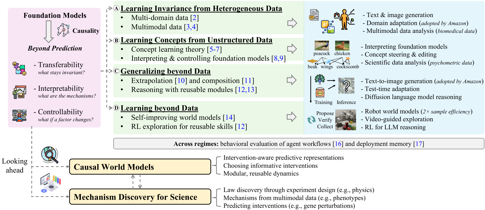

<figure class="wide-figure">

<figcaption>My research at a glance. Bracketed numbers, here and in the text below, refer to the <a href="#publications">publication list</a>.</figcaption>
</figure>

[Overview](#overview) · [Causality for ML](#causality-for-ml) · [ML for causality](#ml-for-causality) · [Publications](#publications)

## Beyond Prediction {#overview}

I develop **causal representation learning**: recovering the concepts and mechanisms behind complex data. A model can predict well and still be wrong about what happens under change, because several mechanisms can fit the same observations. My research connects causality and machine learning in two directions:

- **[Causality for machine learning](#causality-for-ml):** causal principles make models **transferable**, **interpretable**, and **controllable**.
- **[Machine learning for causality](#ml-for-causality):** scalable learning makes **causal discovery and inference** feasible for complex observations and large systems.

## I. Causality for machine learning {#causality-for-ml}

I ask which data and structural assumptions **identify** the mechanisms behind observations, then turn those conditions into scalable learning methods. The work serves three properties we want from machine learning models.

### Transferability {#transfer}

*What carries over when the environment changes?*

- **Adaptation:** variation across domains reveals which mechanisms are **shared** and which **change**; the shared part transfers .
- **Extrapolation:** learned mechanisms extend beyond the training support . **Composition** is the special case of new combinations of known concepts, in image generation  and language-model reasoning .
- **Exploration:** when the data in hand cannot identify what transfers, the model seeks the **missing evidence**, guided by verification signals that transfer to unseen situations in world models  and by the coverage that reusable reasoning skills need .
- **Multimodal world models:** reusable dynamics that anticipate the consequences of actions and transfer across environments, continuing the multimodal and exploration lines.

### Interpretability {#interpret}

*Which concepts and mechanisms generate the data?*

- **Theory:** structural assumptions that identify **hierarchical concepts** without labels, for nonlinear  and discrete  latent hierarchical models.
- **Understanding models:** masked autoencoders , generative models , and feature consistency in sparse autoencoders .
- **Multimodal:** modular vision-language alignment that matches concepts across images and text .

### Controllability {#control}

*What happens if one factor changes?*

- **Idea:** identified concepts are handles for **targeted change**: alter one factor and predict the outcome.
- **Controllable generation:** multi-domain image translation , counterfactual generation , and attribute-guided image generation .
- **Multimodal:** vision and language concepts that steer image generation .

### From principles to practice {#practice}

- **Data at scale:** **mechanism-guided synthetic data generation** for training [IFM's K2 models](https://ifm.ai/k2/), a frontier family of open-source language models . I was a core contributor to the training data.
- **Evaluation:** does learning change behavior? CHI-Bench  tests agents on long, policy-rich healthcare workflows, and our position paper  argues for behavioral evidence beyond perplexity.

## II. Machine learning for causality {#ml-for-causality}

*How far can flexible learning and large-scale computation extend causal discovery and inference?*

- **Scientific data:** scalable representation learning recovers causal structure from real measurements: latent hierarchies in psychometric data  and mechanisms in multimodal biomedical observations .
- **Mechanism discovery for science:** a cycle in which candidate mechanisms suggest experiments, and the observations revise both the model and the next experiment, in collaboration with domain scientists.
- **Principled black-box causal inference:** how can causal inference become a scalable machine learning task while keeping its theoretical guarantees, such as **identifiability**?

## Publications {#publications}

  <em>* indicates co-first authorship. Numbers count up from the bottom of the list, so they stay fixed as new papers are added at the top.</em>


